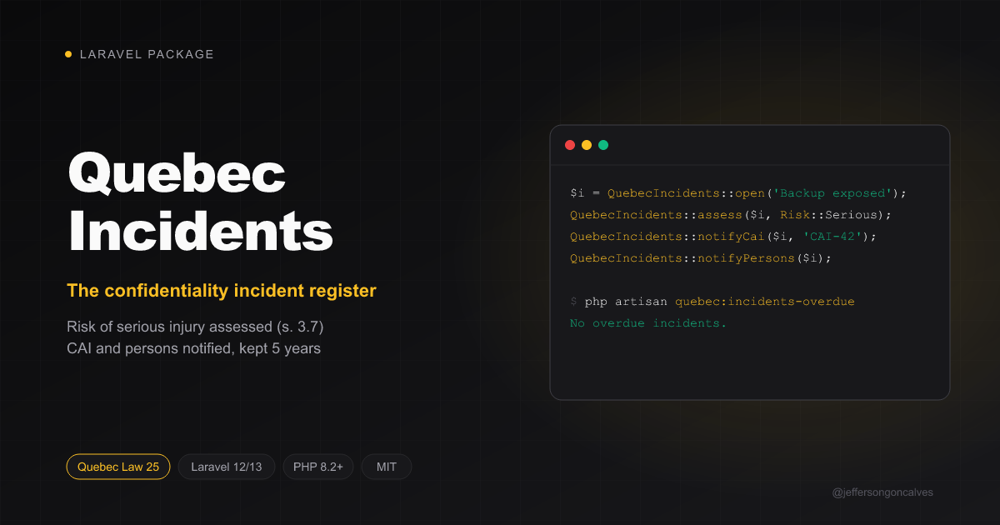

# Laravel Quebec Incidents



[](https://packagist.org/packages/jeffersongoncalves/laravel-quebec-incidents)
[](https://github.com/jeffersongoncalves/laravel-quebec-incidents/actions/workflows/tests.yml)
[](https://packagist.org/packages/jeffersongoncalves/laravel-quebec-incidents)

Confidentiality incidents under Quebec's private sector privacy act (Law 25). It is part of the [laravel-quebec](https://github.com/jeffersongoncalves/laravel-quebec) suite.

A confidentiality incident is any access, use or communication of personal information not authorized by law, its loss, or any other breach of its protection (s. 3.6). Under Law 25 and the Regulation respecting confidentiality incidents, you must:

- take reasonable measures to reduce the risk of injury and prevent new incidents (s. 3.5);
- assess whether the incident presents a **risk of serious injury**, weighing the sensitivity of the information, the anticipated consequences of its use and the likelihood that it will be used for injurious purposes (s. 3.7);
- if it does, **promptly notify** the Commission d'accès à l'information (CAI) and every person whose information is concerned (s. 3.5). A public notice may replace individual ones in some cases (s. 5 of the regulation), and the persons' notice may wait while it could hamper an investigation;
- keep a **register** of every incident, serious or not (s. 3.8), for at least 5 years after you became aware of it (s. 11 of the regulation), and send it to the CAI on request.

This package is that register, with the assessment and the notices tracked on each entry.

> This package gives you tooling. It does not make you compliant on its own. You still need legal review, for example to assess the risk and write the notices.

## Installation

```bash
composer require jeffersongoncalves/laravel-quebec-incidents
php artisan vendor:publish --tag="quebec-incidents-migrations"
php artisan migrate
php artisan vendor:publish --tag="quebec-incidents-config"
```

## Usage

```php
use JeffersonGoncalves\QuebecIncidents\Enums\Risk;
use JeffersonGoncalves\QuebecIncidents\Facades\QuebecIncidents;

$incident = QuebecIncidents::open('Backup exposed on a public bucket', discoveredAt: now(), attributes: [
    'circumstances' => 'Misconfigured storage policy',
    'occurred_at' => now()->subDays(2),
    'data_categories' => ['name', 'email', 'address'],
    'affected_persons' => 1200,
    'measures' => 'Bucket made private, keys rotated',
]);

QuebecIncidents::assess($incident, Risk::Serious,
    sensitivity: 'Contact details',
    consequences: 'Phishing, identity theft',
    likelihood: 'Bucket indexed by search engines',
);

QuebecIncidents::notifyCai($incident, reference: 'CAI-2026-0042');
QuebecIncidents::notifyPersons($incident);
// or: QuebecIncidents::notifyPublicly($incident, 'No contact details for most persons');
// or: QuebecIncidents::deferPersonsNotice($incident, 'Police investigation in progress');

QuebecIncidents::close($incident);
```

An incident assessed as `Risk::NotSerious` stays in the register and owes no notice.

### Queries

```php
use JeffersonGoncalves\QuebecIncidents\Models\Incident;

Incident::query()->scopes('pending')->get();  // not assessed, or a notice still owed
Incident::query()->scopes('overdue')->get();  // past your notice target, CAI not notified
Incident::query()->scopes('expired')->get();  // past the 5-year keeping period
```

### Notice target

The act says "promptly" and sets no hours. `quebec-incidents.notice_target` (default `72 hours`, counted from discovery) is your own target. Schedule the check:

```php
Schedule::command('quebec:incidents-overdue')->hourly();
```

It fires `IncidentOverdue` for every incident not assessed, or not notified to the CAI, by that target. `IncidentOpened` fires when an incident is registered.

## Testing

```bash
composer test
```

## Changelog

See [CHANGELOG](CHANGELOG.md).

## License

The MIT License (MIT). See [License File](LICENSE.md).
